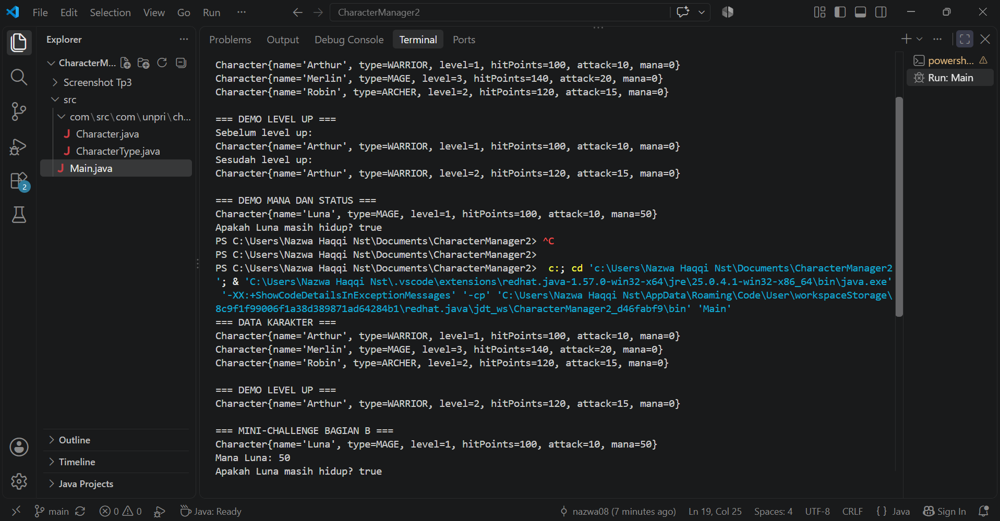
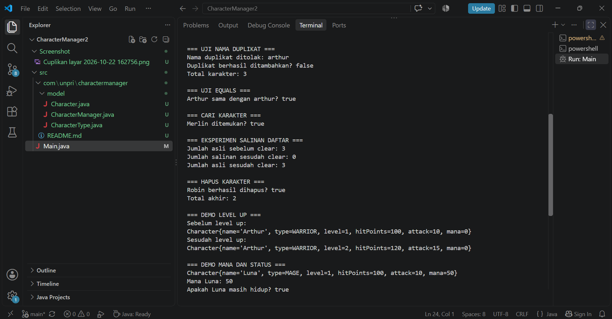
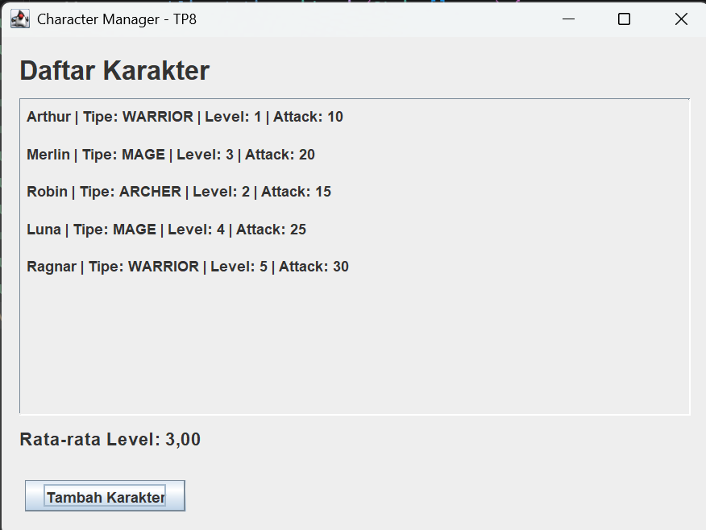

# Character Manager — TP3 (Java Visual SIH-6406)

## Deskripsi
Character Manager adalah program berbasis Java yang dibuat untuk mengelola data karakter menggunakan konsep Object-Oriented Programming (OOP). Program ini menerapkan encapsulation, constructor, enum, getter dan setter, serta fitur pengaturan level, HP, attack, dan mana karakter. Program juga memiliki method `isAlive()` untuk memeriksa apakah karakter masih hidup.

## Screenshot Output Program

Berikut adalah screenshot hasil program yang menampilkan data karakter, demo level up, mana, dan hasil pemeriksaan `isAlive()`.



## Struktur Folder Project

```text
javavisual-tp03-[NIM]/
├── README.md
├── screenshots/
│   └── output.png
└── CharacterManager/
    └── src/
        ├── Main.java
        └── com/
            └── unpri/
                └── charactermanager/
                    └── model/
                        ├── Character.java
                        └── CharacterType.java
```

## Identitas Mahasiswa

- **Nama Lengkap:** [Nazwa Haqqi Nasution]
- **NIM:** [253303621233]
- **Link Google Docs Bagian
- :https://1drv.ms/w/c/4c356e610a8583e8/IQAcDgvfKxUSRZ38z01dYsNrAVDUGcBMpsj7cI1MxwJqp9A?e=rvmlqY

_________________________________________________________________________________________________

# Character Manager Sprint #2 — TP5

## 1. Identitas Tugas

- **Nama:** [Nazwa Haqqi Nasution]
- **NIM:** [253303621233]
- **Link Google Docs:** [https://1drv.ms/w/c/4c356e610a8583e8/IQBwBxDYEQ5vT4MfSUDuHigSAUPIBxQTeYeExxACF3ei2j8?e=Y10Fav]

---

## 2. Deskripsi Proyek

Character Manager Sprint #2 merupakan program berbasis Java yang digunakan untuk mengelola karakter dalam sebuah game. Program ini menerapkan konsep Object-Oriented Programming (OOP), khususnya class, object, encapsulation, reference, method overriding, dan pengelolaan kumpulan objek.

Program memiliki class `Character` untuk menyimpan informasi karakter, enum `CharacterType` untuk menentukan tipe karakter, serta class `CharacterManager` untuk mengelola daftar karakter. Program diuji melalui `Main.java` untuk memastikan setiap fitur berjalan sesuai kebutuhan.

## 3. Tujuan

Tujuan pembuatan program ini adalah:

1. Memahami penggunaan class dan object dalam Java.
2. Menerapkan encapsulation melalui atribut `private` dan method yang sesuai.
3. Mengimplementasikan `equals()` untuk membandingkan nama karakter.
4. Mengelola karakter menggunakan `CharacterManager`.
5. Mencegah penambahan karakter dengan nama duplikat.
6. Memahami perbedaan referensi objek dan salinan daftar.
7. Menghitung rata-rata level dan mencari karakter berdasarkan tipe.
8. Membuat fitur analitik tambahan untuk mencari karakter dengan attack tertinggi.

## 4. Struktur Folder

```text
CharacterManager2/
├── README.md
├── Screenshot/
│   ├── Cuplikan layar 2026-10-22 162756.png
│   └── Cuplikan layar 2026-10-22 190612.png
└── src/
    ├── Main.java
    └── com/
        └── unpri/
            └── charactermanager/
                └── model/
                    ├── Character.java
                    ├── CharacterType.java
                    └── CharacterManager.java
```

Keterangan:

- `Main.java`: menjalankan program dan menguji fitur-fitur yang dibuat.
- `Character.java`: menyimpan data karakter seperti nama, tipe, level, HP, attack, dan mana.
- `CharacterType.java`: mendefinisikan tipe karakter menggunakan enum.
- `CharacterManager.java`: mengelola daftar karakter dan menyediakan method pencarian serta analitik.
- `README.md`: dokumentasi proyek.
- `Screenshot/`: menyimpan bukti hasil pengujian program.

## 5. Implementasi Fitur

### A. Implementasi Core

**1. `equals()`**

Method `equals()` digunakan untuk membandingkan nama karakter tanpa membedakan huruf besar dan kecil. Contohnya, nama `Arthur` dan `arthur` dianggap sama.

**2. `addCharacter()`**

Method ini menambahkan karakter ke daftar. Jika nama karakter sudah digunakan, penambahan ditolak agar tidak terjadi duplikasi.

**3. `findByName()`**

Method ini mencari karakter berdasarkan nama. Jika karakter ditemukan, objek karakter dikembalikan; jika tidak ditemukan, hasilnya `null`.

**4. `removeCharacter()`**

Method ini menghapus karakter berdasarkan nama dan mengembalikan status keberhasilan penghapusan.

**5. `getTotalCharacters()`**

Method ini mengembalikan jumlah karakter yang tersimpan dalam daftar.

**6. `getAllCharacters()`**

Method ini mengembalikan salinan daftar karakter, bukan daftar internal secara langsung. Dengan demikian, perubahan pada daftar salinan tidak menghapus atau mengubah isi daftar internal `CharacterManager`.

### B. Mini-Challenge

**1. `getAverageLevel()`**

Method ini menghitung rata-rata level seluruh karakter dengan menjumlahkan level dan membaginya dengan jumlah karakter. Jika daftar kosong, method mengembalikan `0` untuk mencegah pembagian dengan nol.

**2. `findByType(CharacterType type)`**

Method ini mencari semua karakter yang memiliki tipe tertentu dan mengembalikan daftar hasil pencarian. Contohnya, pencarian tipe `MAGE` menghasilkan karakter Merlin.

### C. Fitur Analitik Rancangan Sendiri — `findStrongest()`

Fitur tambahan yang dibuat adalah `findStrongest()`, yaitu method untuk mencari karakter dengan nilai attack tertinggi.

Method memeriksa daftar karakter satu per satu, lalu membandingkan nilai attack untuk menentukan karakter terkuat. Jika daftar karakter kosong, method mengembalikan `null`.

Fitur ini menjaga encapsulation karena tidak mengembalikan `ArrayList` internal milik `CharacterManager`. Method hanya mengembalikan satu objek `Character`, sehingga pemanggil dapat mengetahui karakter terkuat tanpa memperoleh akses langsung ke daftar internal.

**Alasan pemilihan fitur:**

Fitur ini berguna untuk mengetahui karakter dengan kekuatan serangan tertinggi. Selain itu, fitur ini melatih penggunaan perulangan, percabangan, perbandingan nilai, dan penanganan kondisi ketika daftar kosong.

## 6. Hasil Pengujian

Pengujian dilakukan menggunakan tiga karakter:

| Nama | Tipe | Level | HP | Attack |
|---|---|---:|---:|---:|
| Arthur | WARRIOR | 1 | 100 | 10 |
| Merlin | MAGE | 3 | 140 | 20 |
| Robin | ARCHER | 2 | 120 | 15 |

Hasil pengujian yang diharapkan:

1. Ketiga karakter berhasil ditambahkan.
2. Nama duplikat `arthur` ditolak karena karakter `Arthur` sudah ada.
3. Perbandingan `Arthur` dan `arthur` menggunakan `equals()` menghasilkan `true`.
4. Pencarian karakter `Merlin` berhasil.
5. Menghapus isi daftar salinan tidak mengubah daftar asli.
6. Rata-rata level ketiga karakter menghasilkan `2.0`.
7. Pencarian tipe `MAGE` menemukan Merlin.
8. Rata-rata level pada daftar kosong menghasilkan `0.0`.
9. Fitur `findStrongest()` menemukan Merlin dengan attack `20`.
10. Fitur `findStrongest()` mengembalikan `null` ketika daftar kosong.
11. Penghapusan Robin berhasil dan jumlah karakter berkurang.

Hasil aktual dapat dilihat pada screenshot output program yang disimpan di folder `Screenshot/`.

## 7. Penjelasan Encapsulation dan Reference

Encapsulation diterapkan dengan menjadikan daftar karakter sebagai atribut `private` di dalam `CharacterManager`. Daftar tersebut tidak dapat diakses langsung dari luar class. Pengelolaan data dilakukan melalui method yang disediakan.

Reference adalah variabel yang merujuk pada objek. Jika dua variabel menunjuk objek yang sama, perubahan melalui salah satu variabel dapat terlihat melalui variabel lainnya. Oleh karena itu, pengembalian daftar salinan melalui `getAllCharacters()` membantu mencegah pemanggil mengubah struktur daftar internal secara langsung.

Konsep tersebut penting agar data karakter tetap terkontrol dan perilaku program lebih mudah diprediksi.

## 8. Cara Menjalankan Program

1. Buka folder `CharacterManager2` menggunakan Visual Studio Code.
2. Pastikan Java sudah terpasang dan ekstensi Java di VS Code berfungsi.
3. Buka file `src/Main.java`.
4. Jalankan method `main()` dengan menekan tombol **Run**.
5. Periksa hasil pengujian pada Terminal.

## 9. Screenshot Hasil Program



## 10. Kesimpulan

Program Character Manager Sprint #2 berhasil menggabungkan pengelolaan objek karakter dengan berbagai fitur pencarian dan analitik. Implementasi `equals()` membantu membandingkan nama karakter, sedangkan `CharacterManager` mengelola penambahan, pencarian, dan penghapusan karakter. Mini-challenge menambahkan kemampuan menghitung rata-rata level dan mencari karakter berdasarkan tipe. Fitur `findStrongest()` melengkapi program dengan pencarian karakter yang memiliki attack tertinggi.

Melalui proyek ini, konsep encapsulation dan reference dapat dipahami melalui implementasi dan pengujian langsung. Program juga menunjukkan pentingnya menjaga akses terhadap data internal agar pengelolaan objek lebih aman dan terstruktur.


---------------

# Character Manager — TP8
## MainWindow, Data Dinamis & Analisis MVC

### Identitas
- **Nama:** [Nazwa Haqqi Nasution]
- **NIM:** [253303621233]
- **Kelas:** [Pagi A]
- **Mata Kuliah:** Praktik Pemrograman Berorientasi Objek (Java)

---

## 1. Deskripsi Proyek

Character Manager adalah aplikasi sederhana berbasis Java yang digunakan untuk mengelola data karakter. Pada TP8, aplikasi dikembangkan menggunakan Java Swing agar data karakter dapat ditampilkan melalui antarmuka grafis (GUI).

Aplikasi menampilkan nama karakter, tipe, level, dan attack. Selain itu, terdapat fitur tambah karakter melalui tombol, validasi nama duplikat, serta perhitungan rata-rata level yang diperbarui setelah karakter berhasil ditambahkan.

## 2. Teknologi yang Digunakan

- Java
- Java Swing
- Object-Oriented Programming (OOP)
- Konsep MVC (Model dan View)

## 3. Struktur Folder

```text
CharacterManager2/
├── README.md
├── Screenshot/
│   ├── tp8-sebelum.png
│   └── tp8-setelah.png
└── src/
    ├── Main.java
    └── com/
        └── unpri/
            └── charactermanager/
                ├── model/
                │   ├── Character.java
                │   ├── CharacterType.java
                │   └── CharacterManager.java
                └── view/
                    └── MainWindow.java
```

## 4. Fitur Aplikasi

### A. Daftar Karakter Dinamis
Aplikasi menampilkan seluruh karakter berdasarkan data yang dikelola oleh `CharacterManager`. Daftar dibuat menggunakan perulangan sehingga tidak perlu membuat `JLabel` secara manual untuk setiap karakter.

### B. Tambah Karakter
Pengguna dapat menekan tombol **Tambah Karakter**, kemudian mengisi nama, tipe karakter, dan level melalui formulir. Karakter baru ditambahkan ke `CharacterManager` jika datanya valid.

### C. Validasi Data
Aplikasi memeriksa nama yang kosong, level yang bukan angka, level kurang dari 1, dan nama karakter yang sudah digunakan. Jika data tidak valid atau nama duplikat, aplikasi menampilkan pesan peringatan.

### D. Statistik Rata-rata Level
Aplikasi menghitung rata-rata level seluruh karakter yang terdaftar. Setelah karakter baru berhasil ditambahkan, daftar dan statistik diperbarui secara langsung.

Rumus yang digunakan:

Rata-rata Level = Total Level Seluruh Karakter / Jumlah Karakter

Jika belum ada karakter, rata-rata ditampilkan sebagai `0.00`.

### E. Pemrograman Event-Driven
Tombol tambah menggunakan `addActionListener()` untuk menjalankan proses penambahan ketika pengguna mengklik tombol. GUI dijalankan melalui `SwingUtilities.invokeLater()`.

## 5. Data Karakter Awal

Aplikasi dimulai dengan lima karakter berikut:

| Nama | Tipe | Level |
|---|---|---:|
| Arthur | WARRIOR | 1 |
| Merlin | MAGE | 3 |
| Robin | ARCHER | 2 |
| Luna | MAGE | 4 |
| Ragnar | WARRIOR | 5 |

Total level awal adalah 15 dengan jumlah lima karakter. Oleh karena itu, rata-rata level awal adalah **3.00**.

## 6. Screenshot Pengujian

### A. Tampilan Awal



Tampilan awal menunjukkan lima karakter beserta tipe, level, attack, dan rata-rata level sebesar 3.00.

### B. Setelah Menambah Karakter


Pengujian dilakukan dengan menambahkan karakter Thor bertipe WARRIOR pada level 6. Jumlah karakter menjadi enam dan total level menjadi 21, sehingga rata-rata level berubah menjadi **3.50**.

### C. Hasil Pengujian

- Lima karakter awal berhasil ditampilkan.
- Karakter baru dapat ditambahkan melalui tombol.
- Nama karakter duplikat ditolak.
- Input level yang tidak valid ditolak.
- Daftar dan rata-rata level diperbarui setelah penambahan berhasil.

## 7. Alur Data dan Konsep MVC

Alur data aplikasi dimulai dari `Main.java`, yang membuat objek karakter dan memasukkannya ke `CharacterManager`. `CharacterManager` bertugas mengelola data karakter, termasuk penambahan dan pengambilan daftar karakter. `MainWindow.java` berperan sebagai View yang menampilkan daftar, menerima interaksi tombol, dan memperbarui statistik. Ketika tombol tambah ditekan, View meneruskan data baru ke `CharacterManager`, lalu menampilkan kembali data terbaru.

Pada implementasi ini, Model dan View sudah dipisahkan, tetapi belum terdapat kelas Controller yang berdiri sendiri. Dengan demikian, pengolahan event tombol masih dilakukan di dalam `MainWindow`.

## 8. Cara Menjalankan Program

1. Buka folder `CharacterManager2` di Visual Studio Code.
2. Pastikan seluruh file Java berada di struktur folder yang benar.
3. Buka `Main.java`.
4. Klik **Run**.
5. Tekan tombol **Tambah Karakter** untuk memasukkan karakter baru.
6. Isi nama, tipe, dan level, lalu tekan **OK**.
7. Periksa daftar dan statistik yang diperbarui.

**Catatan:** Data karakter disimpan di memori selama aplikasi berjalan. Karakter yang ditambahkan melalui GUI tidak tersimpan secara permanen setelah aplikasi ditutup.

## 9. Analisis Google Docs — Bagian D

Dokumen analisis TP8:

[https://1drv.ms/w/c/4c356e610a8583e8/IQDeZjMSJgIvTa_9C3BsIIesASVtui51J7DV_7JvOIbjogQ?e=1rNplt]

Nama dokumen yang disarankan: `JavaVisual_TP08_[NIM]_[Nama]`

Dokumen berisi analisis minimal 500 kata mengenai:
1. Program sekuensial dan event-driven.
2. Fungsi `SwingUtilities.invokeLater()`.
3. Kesalahan `JFrame` yang tidak menampilkan jendela.
4. Hubungan *is-a* dan *has-a*.
5. Tanggung jawab View dan Controller dalam MVC.

## 10. Kesimpulan

Melalui TP8, aplikasi Character Manager dikembangkan dengan antarmuka Java Swing yang menampilkan data secara dinamis. Pengguna dapat menambahkan karakter melalui tombol, memvalidasi masukan, dan melihat rata-rata level yang berubah sesuai data terbaru. Implementasi ini juga memperkuat pemahaman tentang event-driven programming, pemisahan Model dan View, serta konsep dasar MVC.

